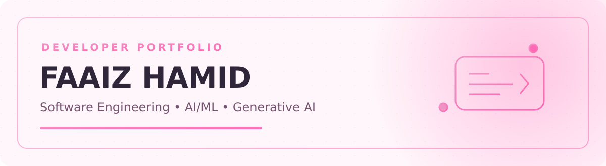

<!-- GitHub Profile README | faaizhamid07 -->
<!-- Banner assets: save the same design as assets/banner-light.svg and assets/banner-dark.svg. -->

  <picture>
    <source media="(prefers-color-scheme: dark)" srcset="./assets/banner-dark.svg" />
    <source media="(prefers-color-scheme: light)" srcset="./assets/banner-light.svg" />
    
  </picture>

<h1 align="center">Hey there, I'm Faaiz Hamid 👋</h1>

  

  
  
  

<b>Computer Science • Software Engineering • Generative AI • Machine Learning • Analytics</b>

---

<h2 align="center">✨ About Me</h2>

<table align="center"><tr>
<td width="65%" valign="top">

I'm a Computer Science engineer pursuing an **M.Tech in Information Technology at USICT, GGSIPU**, with a B.Tech in Computer Science & Engineering from **Jamia Hamdard**.

I build practical software that connects **AI, backend systems, data, and intuitive interfaces**—from RAG applications that route queries intelligently to facial verification systems and analytics dashboards.

- 🧠 **Focus:** Generative AI, ML, backend engineering, and full-stack software
- ⚙️ **Building with:** Python, FastAPI, React, TypeScript, LangGraph and Docker
- ☁️ **Learning through projects:** Deployment, testing, CI/CD and reliable systems
- 📊 **Also exploring:** Data modelling, Power BI and data-driven decision making
- 🤝 **Open to:** Software engineering and AI/ML opportunities

</td>
<td width="35%" align="center" valign="middle">
  
  
Build • Learn • Iterate

</td>
</tr></table>

---

<h2 align="center">🚀 Featured Projects</h2>

<table>
<tr>
<td width="50%" valign="top">
<h3>🧠 <a href="https://github.com/faaizhamid07/Knowra-RAG-Chatbot-with-Dynamic-Retrieval">Knowra — Dynamic RAG Chatbot</a></h3>
Multi-source RAG application using intelligent routing across an LLM, local documents, and web search. Includes streaming responses, document indexing, and a full-stack interface.
  <b>Stack:</b> FastAPI · React · TypeScript · LangGraph · Groq · ChromaDB · Tavily
  <a href="https://knowra-app.yellowbeach-6793485e.uaenorth.azurecontainerapps.io">Live demo</a> · <a href="https://github.com/faaizhamid07/Knowra-RAG-Chatbot-with-Dynamic-Retrieval">Source code</a>
</td>
<td width="50%" valign="top">
<h3>👁️ <a href="https://github.com/faaizhamid07/Face_X_Project">Face-X — Facial Verification</a></h3>
Computer vision application for facial verification using a Siamese neural network, with registration, model training, and verification flows in a web interface.
  <b>Stack:</b> Python · TensorFlow · FastAPI · React · OpenCV
  <a href="https://github.com/faaizhamid07/Face_X_Project">Source code</a>
</td>
</tr>
<tr>
<td width="50%" valign="top">
<h3>📊 <a href="https://github.com/faaizhamid07/Supply-Chain-Visibility-and-Optimization-Analytics">Supply Chain Analytics</a></h3>
Power BI dashboards developed during an Infosys virtual internship, analyzing approximately <b>1.1 million AIS observations</b> for transportation visibility and operational KPIs.
  <b>Stack:</b> Power BI · Power Query · DAX · Data Modelling
  <a href="https://github.com/faaizhamid07/Supply-Chain-Visibility-and-Optimization-Analytics">Source code</a>
</td>
<td width="50%" valign="top">
<h3>📡 <a href="https://github.com/faaizhamid07/Telegram-Signal-Personal">Telegram Signal</a></h3>
Local-first monitoring dashboard that organizes keyword matches from selected Telegram groups, with searchable results and optional bot alerts.
  <b>Stack:</b> FastAPI · React · Telethon · SQLite
  <a href="https://github.com/faaizhamid07/Telegram-Signal-Personal">Source code</a>
</td>
</tr>
</table>

<a href="https://github.com/faaizhamid07?tab=repositories"><b>Explore all repositories →</b></a>

---

<h2 align="center">🛠️ Tech Stack</h2>

<b>Languages &amp; Frameworks</b>

<b>AI, Data &amp; Infrastructure</b>

  
  
  
  

---

<h2 align="center">📈 GitHub Activity</h2>

  

  

---

<h2 align="center">🐍 Contribution Snake</h2>

<!-- Generated by .github/workflows/snake.yml and published to the output branch. -->

  <picture>
    <source media="(prefers-color-scheme: dark)" srcset="https://raw.githubusercontent.com/faaizhamid07/faaizhamid07/output/github-contribution-grid-snake-dark.svg" />
    <source media="(prefers-color-scheme: light)" srcset="https://raw.githubusercontent.com/faaizhamid07/faaizhamid07/output/github-contribution-grid-snake.svg" />
    
  </picture>

---

<h2 align="center">🤝 Connect With Me</h2>

  
  
  

More social links can be added when you want to share them publicly.

